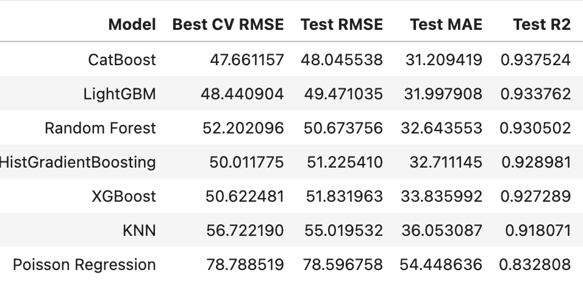
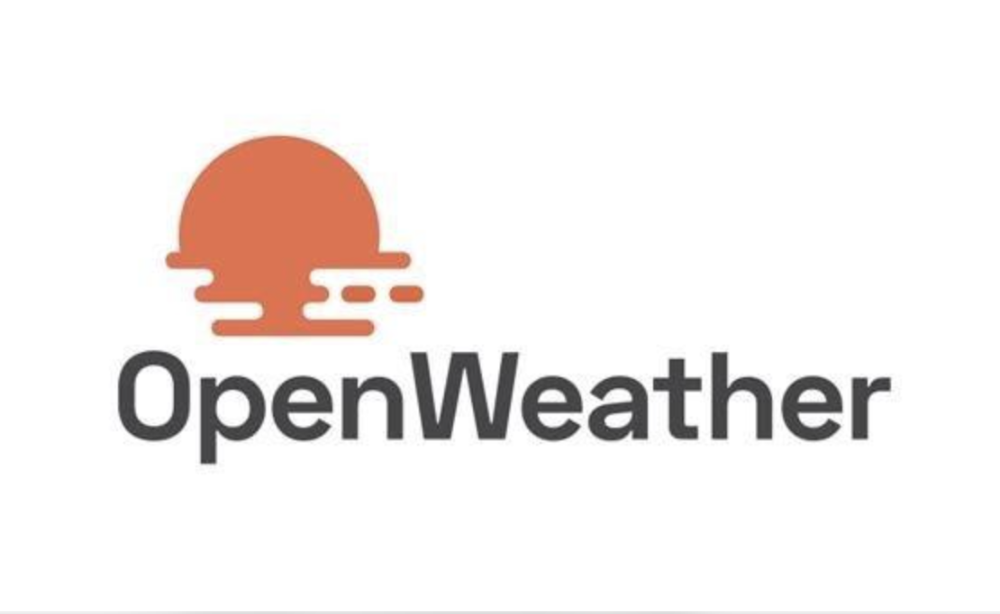

# 🚲 BikeCast – Forecasting Bike-Sharing Demand 

Welcome to our machine learning project that predicts hourly bike-sharing demand!  

It covers Berlin, Cologne, and Dresden, and uses weather and calendar information to evaluate how many bikes will be needed on a given day at a given hour.

## 📌 Project Overview

With climate crisis becoming an increasingly urgent issue, it is the right time to think about the ways we can reduce our impact on the environment 🌱

**[UN Act Now](https://www.un.org/en/actnow/ten-actions)** lists **biking** among 10 things that each of us can do to move towards this goal, but biking does come with its difficulties:               
A comfortable bike is quite expensive, it might get stolen, and it might require some technical skills should anything break down. Not to mention a miserable biking experience in the rain 🌧️

**Bike-sharing companies** help us with many of these difficulties: A shared bike does not require a big one-time investment, it does not get stolen from you personally, and you don't need to worry about its maintenance. Rain is still gonna be there though! 

What can be really annoying about a bike-sharing service, however, is when you really need a bike but so do all of your neighbours - and there are **no free bikes available**.

To help solve this problem, we designed **an interactive web app** that would allow **bike-sharing companies** to **predict the demand** and prepare enough bikes, so that their customers do not get stranded.

Our app predicts bike-sharing demand in **Berlin, Cologne, and Dresden**, based on **weather forecasts** (*Is it cold and rainy or sunny and warm?*), **time** (*Is it the dead of night or a busy commuting hour?*) and **calendar** factors (*Is it July or December? It is a working day or not?*)

Behind our app is **a machine learning model** (CatBoost, see below) trained on historical bike-sharing and weather data. It uses **real-time weather forecasts** to make bike demand predictions, and **a cloud-hosted database** to display bike demand trends.

  
   
  <em>App homepage</em>

## 🚀 Try Our Web App

👉 **[Click here to explore BikeCast](https://bikecast-app.streamlit.app/)**

The application offers three main features:

**Data Visualization**: Explore how weather, time, location, and calendar factors influence bike-sharing demand.

**Automatic Prediction**: Predict hourly demand up to five days ahead using weather forecasts retrieved via the OpenWeather API and automatically generated calendar factors.

**Manual Prediction**: Predict hourly demand for future dates or hypothetical weather and calendar scenarios by manually entering all the factors yourself.

## 📊 Data

### Dataset

We trained our machine learning model on historical bike-sharing records from Berlin, Cologne, and Dresden covering August 2022 – July 2023, with 1.2 to 2.5 million trips per city.

We aggregated the records of individual bike-sharing trips to hourly bike demand, and added historical weather and calendar data to each hour. This resulted in a modeling dataset of ≈22,000 observations.

**Target of prediction:**
- **Shared bike trips**: Number of bike-sharing trips started per hour. It represents the demand for ready-to-use bikes that a company needs to prepare.

**Predictor factors:**
- **Location:** City.
- **Calendar factors:** Month, hour of the day, working day (vs. holiday/weekend), and school holidays (*Schulferien* vs. regular school periods).
- **Weather factors:** Weather conditions (clouds, clear, rain, snow, mist, drizzle or fog), temperature, humidity, wind speed, amount of rainfall and snowfall during the previous hour.

### Data Sources

- **Bike-Sharing Data:** Historical bike-sharing records obtained from the [European Bike Sharing Dataset](https://github.com/tumftm/european-bike-sharing-dataset)¹.
- **Weather Data:** Historical weather records collected using the [OpenWeather Marketplace](https://openweathermap.org/marketplace), including temperature, humidity, wind speed, rainfall, and snowfall.
- **Calendar Data:** Working day information generated using `holidays` library in Python; school break information taken from the [Schulferien website](https://www.schulferien.org/deutschland/ferien/).

## 🤖 Machine Learning & Model Performance

The final model uses **CatBoost**, a gradient boosting algorithm, to capture complex non-linear relationships between bike-sharing demand and the predictor factors.

The model was evaluated on unseen historical data.

| Metric                            | Score |
| --------------------------------- | ----- |
| R² (coefficient of determination) | 0.93  |

The model explains **93% of the variance in hourly bike-sharing demand** in the evaluation dataset. This means it captures most of the patterns behind why the number of bike rentals changes from one hour to another. The remaining 7% may be influenced by other factors that are not included in our model.

Before selecting our final model, we tested 6 other ones - you can see their results below. A more detailed overview of the model selection process (including hyperparameter tuning) can be found in *Data_Processing_and_Modelling* > *predictive_modelling.ipynb*.

  
   
  <em>ML model comparison</em>

## ⚙️ End-to-End Project Workflow

1. **Data collection:** Integration of historical bike-sharing and weather data.
2. **Data preprocessing:** Data cleaning, hourly aggregation, and timezone conversion.
3. **Feature engineering:** Creation of weather categories (clouds, clear, rain, snow, mist, drizzle or fog), calendar factors (working day and school break) and cyclical spline-based representations for hours of the day.
4. **Exploratory data analysis:** Investigation of bike demand based on month of the year, hour of the day, city, and weather.
5. **Machine learning:** Model training, comparison, hyperparameter tuning, and performance evaluation.
6. **Cloud database integration:** Storage and retrieval of processed data using a Railway-hosted MySQL database.
7. **Application development and deployment:** Interactive Streamlit application integrating the trained model, cloud database, and live weather forecasts.

## 🛠️ Technologies Used

| Category                        | Technologies                         |
| ------------------------------- | ------------------------------------ |
| Programming & Data Processing   | Python, Pandas                       |
| Machine Learning                | CatBoost, Scikit-learn, xgboost, lightgbm     |
| Database                        | SQL, MySQL                           |
| Cloud Infrastructure            | Railway                              |
| API Integration                 | OpenWeather API                      |
| Application & Deployment        | Streamlit, Streamlit Community Cloud |
| Version Control & Collaboration | Git, GitHub                          |

## 📂 Repository Structure

### App

Contains the deployed Streamlit application, trained models, and supporting functions.

| File | Description |
| --- | --- |
| `app_cloud_db.py` | Main Streamlit application |
| `functions_cloud_db.py` | API integration, database operations, feature preparation, and prediction functions |
| `graphs.py` | Data visualization functions |
| `school_holidays.py` | School holiday information |
| `catboost_categories_spline.pkl` | CatBoost model with spline-based hour feature|
| `catboost_model_spline.pkl` | Categories for CatBoost model |
| `bike.png` | Application image |
| `bikecast_qr.png` | QR code linking to the live application |

### Data_Processing_and_Modelling

Contains Jupyter notebooks documenting the data processing, machine learning, and database setup workflows.

| File | Description |
| --- | --- |
| `data_preparation_for_github.ipynb` | Data cleaning, hourly aggregation, data integration, and feature engineering |
| `predictive_modeling.ipynb` | Model training, hyperparameter tuning, model comparison, and performance evaluation |
| `railway_db_setup.ipynb` | Cloud database setup and data upload to Railway-hosted MySQL |

### images

Contains screenshots and visualizations used in the README.

| File | Description |
| --- | --- |
| `bikecast_homepage.png` | Screenshot of the application homepage |
| `model_comparison.png` | Visualization of machine learning model performance |
| `openweather_logo.png` | OpenWeather logo for data attribution |
| `.gitkeep` | Git directory placeholder |

### Root Directory

| File | Description |
| --- | --- |
| `README.md` | Project overview and documentation |
| `requirements.txt` | Python dependencies |
| `.gitignore` | Git exclusion rules |

## ⚠️ Limitations

- The model was trained on historical data from Berlin, Cologne, and Dresden; its performance in other locations has not been validated.
- OpenWeather only has 3-hour weather forecasts available to the public for free, while hourly forecasts are behind a paywall. This means that our app has access to only one forecast for a 3-hour window, for example, from 09:00 to 12:00, not one forecast for each hour. This reduces the accuracy of the automatic predictions. If you need an accurate prediction for specific known weather conditions, please use the manual prediction option.
- Unobserved factors, such as major events or changes in mobility patterns, may also influence actual demand.

## 👥 Meet the Team

- **Tatiana Pashkova** 
- **Leyla Bakacak Karabenli** 

This project was developed collaboratively, combining data engineering, machine learning, and web application development.

## 📚 Data Attribution

**Historical bike-sharing data**: Waldner et al. (2025), *Data-Driven Insights into (E-)Bike-Sharing*, Transportation. Licensed under [CC BY-NC 4.0](https://creativecommons.org/licenses/by-nc/4.0/).

**Weather data**: [OpenWeather](https://openweathermap.org/).
Historical weather data were used for model training, while live 
weather forecasts are retrieved via the OpenWeather API for 
automatic demand predictions.

## 🔐 Configuration

The application requires:
- Database connection credentials
- An OpenWeather API key
- Purchased historical weather data from OpenWeather Marketplace (our dataset cannot be shared publicly)

