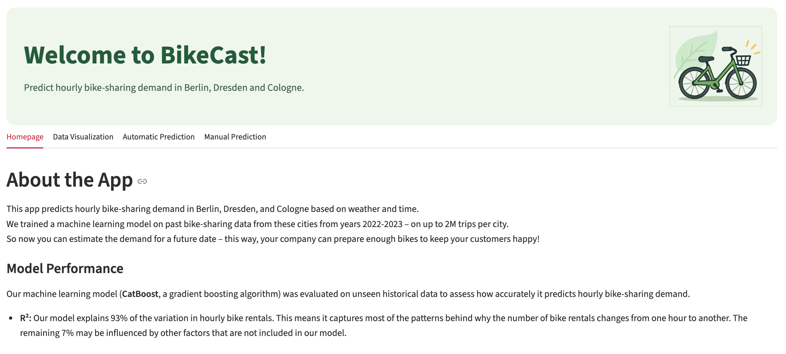

# 🚲 BikeCast – Forecasting Bike-Sharing Demand 

An end-to-end machine learning project that predicts hourly bike-sharing demand in Berlin, Cologne, and Dresden based on weather, temporal, and calendar factors.

## 📌 Project Overview

Accurate demand forecasting can help bike-sharing providers optimize fleet availability, improve resource allocation, and increase customer satisfaction, thus supporting sustainable urban mobility.

We developed and deployed an interactive web application that combines historical bike-sharing data, machine learning, real-time weather forecast integration, and a cloud-hosted database to support data-driven operational planning.

<p align="center">
  
  <br>
  <em>Figure 1. App homepage.</em>
</p>


## 🚀 Try Our Live App

👉 **[Click here to explore BikeCast](https://bikecast-app.streamlit.app/)**

The application offers three main features:

**Data Visualization**: Explore how weather, time, location, and calendar factors influence bike-sharing demand.

**Automatic Prediction**: Forecast hourly demand up to five days ahead using weather forecasts retrieved via the OpenWeather API and automatically generated calendar factors.

**Manual Prediction**: Estimate demand for future dates or hypothetical weather and calendar scenarios by manually entering all the predictor factors.


## 📊 Data

### Dataset

The model was trained on historical bike-sharing records from Berlin, Cologne, and Dresden covering August 2022 – July 2023, with 1.2 to 2.5 million trips per city.

Bike-sharing records were aggregated to hourly demand and enriched with historical weather and calendar data, resulting in a modeling dataset of approximately 22,000 observations.

**Target of prediction:**
- Number of bike-sharing trips started per hour.

**Predictor factors:**
- **Location:** City.
- **Calendar factors:** Month, hour of the day, working day (vs. holiday/weekend), and school holidays (Schulferien vs. regular school periods).
- **Weather factors:** Weather conditions (clouds, clear, rain, snow, mist, drizzle or fog), temperature, humidity, wind speed, rainfall and snowfall during the previous hour.

### Data Sources

- **Bike-Sharing Data:** Historical bike-sharing records obtained from the [European Bike Sharing Dataset](https://github.com/tumftm/european-bike-sharing-dataset)¹.
- **Weather Data:** Historical weather records collected using the [OpenWeather Marketplace](https://openweathermap.org/marketplace), including temperature, humidity, wind speed, rainfall, and snowfall.
- **Calendar Data:** Working day information generated using a Python library; school break information taken from the [Schulferien website](https://www.schulferien.org/deutschland/ferien/).

## 📂 Repository Structure

```text
├── .gitignore
├── README.md
├── app_cloud_db.py
├── bike.png
├── bikecast_qr.png
├── catboost_categories_spline.pkl
├── catboost_model_spline.pkl
├── functions_cloud_db.py
├── graphs.py
├── requirements.txt
└── school_holidays.py
```

## 📄 File Descriptions

| File | Description |
|---|---|
| `.gitignore` | Specifies files and directories that Git should ignore. |
| `README.md` | Contains project documentation and setup instructions. |
| `app_cloud_db.py` | Main Streamlit application for bike-sharing demand prediction with cloud database integration. |
| `bike.png` | Contains the bike image used in the application interface. |
| `bikecast_qr.png` | Contains a QR code that provides quick access to the BikeCast application via GitHub. |
| `catboost_categories_spline.pkl` | Saved CatBoost model for categorical features. |
| `catboost_model_spline.pkl` | Saved CatBoost model using spline-based features. |
| `functions_cloud_db.py` | Contains helper functions for data processing, weather data retrieval, database operations, and predictions. |
| `graphs.py` | Contains functions for generating and displaying data visualizations. |
| `requirements.txt` | Lists the Python dependencies required to run the project. |
| `school_holidays.py` | Contains functionality for handling school holiday information. |

## 🛠️ Technologies Used

- Python
- Streamlit
- CatBoost
- Pandas
- Scikit-learn
- MySQL
- Railway (cloud-hosted MySQL database)
- OpenWeather API


## 🔐 Configuration

The application may require:
- Database connection credentials.
- An OpenWeatherMap API key.

For security reasons, sensitive credentials and API keys should never be committed to the GitHub repository.
